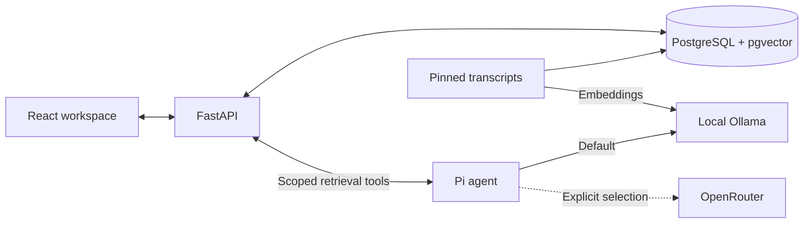

# Lenny Growth Assistant

**Ask a product question. Inspect the evidence. Save a document.**

A local research workspace for Lenny’s Podcast. Search interview transcripts, inspect cited passages, continue a saved conversation, and review writing before exporting it as Markdown or HTML.

[Quick start](#quick-start) · [Reviewed demo](#reviewed-demo) · [Architecture](#architecture) · [Documentation](#documentation) · [Verification](docs/verification.md)

## What it does

- **Research with citations:** chat over indexed transcripts and open the original passage behind a reply.
- **Keep your work:** save conversations, source references, and documents in PostgreSQL.
- **Review and export:** inspect an evidence-led essay, then save Markdown and sandboxed HTML previews.
- **Choose where inference runs:** Ollama is the default. OpenRouter is available through explicit server configuration. The workspace discloses the active provider and model; there is no automatic fallback.

## Reviewed demo

[Read the essay](docs/demo/manually-reviewed-essay.md) · [Download HTML](docs/demo/manually-reviewed-essay.html) · [Export verification](docs/demo/verification.md)

This saved example contains **1,208 words and nine manual edits**. It demonstrates the review and export workflow; it is not a fresh autonomous generation. Both exports match the saved session. The separate frozen A–E acceptance result remains **0/5**; **148/148 backend contracts** passed. [Verification scope](docs/verification.md)

## Quick start

Requires **Git, Python 3.11+, Docker Desktop, Ollama**, and enough available memory for the models and containers. Start Docker Desktop and Ollama first. An 8 GB machine has limited capacity for local generation alongside the stack.

**1. Clone and prepare the local models.**

```sh
git clone https://github.com/vivekvattem/lenny.git
cd lenny
ollama pull qwen3:0.6b
ollama pull qwen3:1.7b
ollama pull nomic-embed-text:latest
```

Skip models already present in `ollama list`. Chat uses Qwen3 0.6B, essay advice uses Qwen3 1.7B, and embeddings use Nomic.

**2. Fetch and verify the pinned transcripts.**

```sh
export CORPUS_REVISION=be8ab89a890a833cbba2c892178f823fff178c65
python3 scripts/fetch_corpus.py --revision "$CORPUS_REVISION"
python3 scripts/verify_snapshot.py --root ".cache/corpus/$CORPUS_REVISION"
```

**3. Start the app and index three demo interviews.**

```sh
python3 scripts/bootstrap.py
python3 scripts/wait_ready.py
python3 scripts/docker.py compose exec -T api python -m backend.ingest \
  --root "/corpus/$CORPUS_REVISION" \
  --source-path episodes/sean-ellis/transcript.md \
  --source-path episodes/shreyas-doshi/transcript.md \
  --source-path episodes/shreyas-doshi-live/transcript.md --deadline-seconds 900
```

Open **[localhost:8080/workspace](http://localhost:8080/workspace)**. Bootstrap creates an ignored `.env` only if absent; the API applies migrations on startup. Readiness alone does not mean the corpus has been indexed. The quick start indexes three interviews, not the full corpus.

Already running Lenny? Preserve its project, ports, and volumes. For a separate evaluator installation, follow [isolated setup](docs/handoff.md#isolated-setup) before bootstrapping.

## Ask → verify → save

1. Create a session and ask: **“How did Sean Ellis change onboarding at Lookout?”**
2. Open a citation and check that the original passage supports the specific answer. For a follow-up, retain the interview scope and inspect its evidence too.
3. Use **Documents** to save Markdown or HTML. Review generated essays before accepting them.

To import the historical reviewed essay into your intended isolated demo database after indexing the three interviews:

```sh
python3 scripts/docker.py compose exec -T api python -m backend.import_reviewed_fixture \
  --expected-database "$POSTGRES_DB"
```

Use the explicit database name from your server configuration. The importer checks source mappings and makes no model call. Open the labelled **Reviewed essay fixture** session and both document formats.

## Architecture



Pi runs narrow, validated tools. PostgreSQL stores transcript snapshots, source spans, sessions, and artifacts. The HTML viewer uses sanitization and a sandboxed iframe. [Architecture details](docs/architecture.md) · [Design decisions](docs/decisions.md)

## Configuration and tests

Use [`.env.example`](.env.example) for server settings. Keep real keys in the ignored `.env`. To select OpenRouter, configure `DEFAULT_PROVIDER=openrouter`, `OPENROUTER_MODEL`, and `OPENROUTER_API_KEY`, then recreate the intended API service. Keys stay server-side. Selected evidence and conversation context leave the machine in cloud mode. This published revision uses server configuration rather than an interactive provider switch.

Run checks separately from service restarts:

```sh
python3 -m unittest scripts.test_wait_ready -v
node --test agent/test_provider_policy.ts agent/test_conversation_policy.ts agent/test_essay_format.ts

# Uses a separate retained contract database on the intended Compose server.
python3 scripts/docker.py compose run --rm --no-deps \
  -e DEFAULT_PROVIDER=ollama -e OPENROUTER_API_KEY= -e ANTHROPIC_API_KEY= \
  api python -m backend.contract_check

# Frontend checks require Node 24.9.0/npm on the host.
npm ci --prefix frontend --ignore-scripts --no-audit --no-fund
npm --prefix frontend run typecheck
npm --prefix frontend run build
node --test frontend/test-source-span.mjs
```

See the [test plan](docs/test-plan.md), [troubleshooting](docs/troubleshooting.md), and [handoff](docs/handoff.md) for manual checks, full ingestion, and recovery. Never remove database volumes to resolve a setup problem.

## Documentation

| Deliverable | Location |
| --- | --- |
| Product requirements and acceptance scenarios | [PRD](docs/PRD.md), [requirements](docs/requirements.md), [scenarios](docs/scenarios.md) |
| Interface and accessibility decisions | [Design](docs/design.md) |
| System architecture and trade-offs | [Architecture](docs/architecture.md), [decisions](docs/decisions.md) |
| Setup, operations, and extension guidance | [Handoff](docs/handoff.md), [troubleshooting](docs/troubleshooting.md) |
| AI coding evidence | [Sanitized evidence](docs/agent-transcripts/README.md); complete conversation export remains unavailable |
| Automated and manual verification | [Test plan](docs/test-plan.md), [results summary](docs/verification.md) |
| Camera demo and submission | [Checklist](docs/submission-checklist.md); verified YouTube URL pending |

The prototype has known answer-completeness, abstention, essay-quality, and local-resource limitations. Contract tests and valid citations do not establish semantic acceptance. [Current limitations](docs/known-issues.md)
