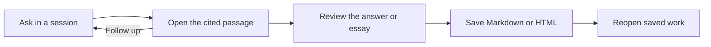
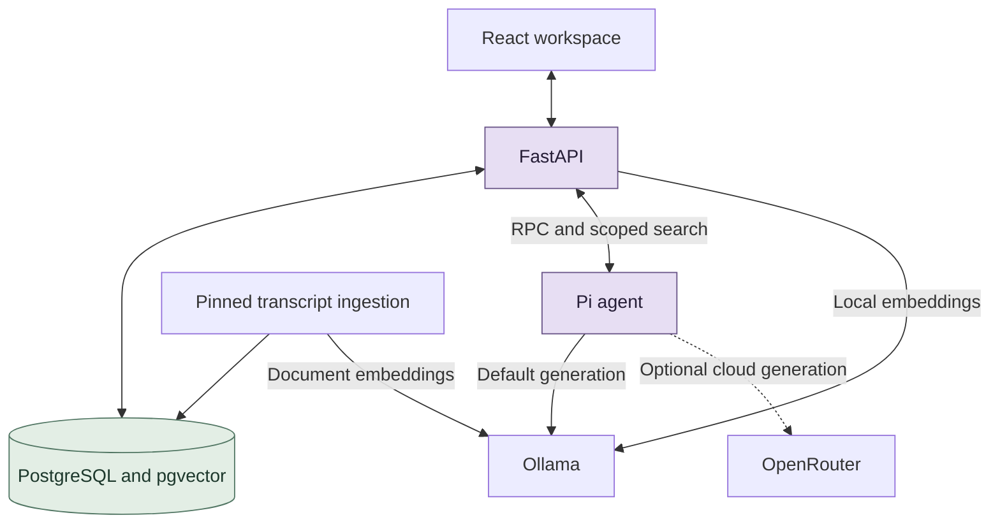

# Lenny Growth Assistant

**Ask a product question. Read the evidence. Save the result.**

Lenny helps product and growth teams turn long podcast interviews into research they can verify and reuse. Ask a question about Lenny’s Podcast, open the original transcript behind the answer, and save a reviewed essay as Markdown or HTML.

[Run locally](#quick-start) · [See the workflow](#try-lenny) · [Architecture](#system-architecture) · [Deliverables](#assignment-deliverables) · [What we verified](#verification-and-limitations)

## Manually reviewed demo

[Read the essay (Markdown)](docs/demo/manually-reviewed-essay.md) · [Download the HTML export](docs/demo/manually-reviewed-essay.html) · [Verification and limitations](docs/demo/verification.md)

This historical reviewed fixture contains **1,208 words and nine manual edits**; it is not a fresh autonomous generation. Both exports were reopened and matched the saved session. The separate frozen acceptance result remains **0/5**, despite **148/148 passing backend contracts**. Rejected chat demos and private evidence are excluded.

## Quick start

On macOS, install **Git, Python 3.11+, Docker Desktop, and Ollama**. Start Docker Desktop and Ollama. If you already run Lenny, use the [isolated setup](#advanced-setup) below to avoid port and database conflicts.

**1. Clone and prepare the models.**

```sh
git clone https://github.com/vivekvattem/lenny.git
cd lenny

ollama pull qwen3:0.6b
ollama pull qwen3:1.7b
ollama pull nomic-embed-text:latest
```

Skip any model already listed by `ollama list`. The first two are used for chat and essay drafting. Nomic supplies the transcript embeddings.

**2. Fetch the pinned transcripts.**

```sh
CORPUS_REVISION=be8ab89a890a833cbba2c892178f823fff178c65
python3 scripts/fetch_corpus.py --revision "$CORPUS_REVISION"
python3 scripts/verify_snapshot.py --root ".cache/corpus/$CORPUS_REVISION"
```

**3. Start Lenny and build the demo index.**

```sh
python3 scripts/bootstrap.py
python3 scripts/wait_ready.py

python3 scripts/docker.py compose exec -T api python -m backend.ingest \
  --root "/corpus/$CORPUS_REVISION" \
  --source-path episodes/sean-ellis/transcript.md \
  --source-path episodes/shreyas-doshi/transcript.md \
  --source-path episodes/shreyas-doshi-live/transcript.md --deadline-seconds 900
```

Open **[Lenny at localhost:8080](http://localhost:8080)** after ingestion finishes. The quick start uses Ollama and a three-interview index. Bootstrap generates an ignored `.env` on first run, and the API applies its database migrations before serving requests.

## Try Lenny

1. **Ask.** Open [the workspace](http://localhost:8080/workspace), create a session, and ask **“How did Sean Ellis change onboarding at Lookout?”**
2. **Verify.** Open the citation to read the exact excerpt. For a context-dependent follow-up, leave **All indexed interviews** selected on both turns and ask **“And what message did those users see after completing that first step?”**
3. **Save.** Use **Documents** to save Markdown or HTML. For longer writing, choose **Evidence-led essay** and review the draft and citations before accepting it.



## System architecture



FastAPI handles sessions, hybrid transcript search, and citation validation. Pi uses a scoped, read-only retrieval tool and calls the selected model. PostgreSQL stores transcripts, conversations, source spans, and artifacts. The viewer renders HTML in a sandboxed iframe. [Architecture](docs/architecture.md) · [Design decisions](docs/decisions.md)

## Assignment deliverables

| # | Deliverable | Where to find it |
| --- | --- | --- |
| 1 | Public source and reproducible setup | [Repository](https://github.com/vivekvattem/lenny), [Compose](compose.yaml), and [example configuration](.env.example) |
| 2 | Setup and handoff | [Quick start](#quick-start), [troubleshooting](docs/troubleshooting.md), and [handoff](docs/handoff.md) |
| 3 | Product requirements | [PRD](docs/PRD.md) and [acceptance scenarios](docs/scenarios.md) |
| 4 | Design | [UI, responsive layout, and accessibility](docs/design.md) |
| 5 | Architecture | [System design](docs/architecture.md) and [technical decisions](docs/decisions.md) |
| 6 | Coding-agent evidence | [Sanitized logs](docs/agent-transcripts/README.md) include failures and fixes. A complete conversation export remains pending. |
| 7 | Tests | [Automated checks and manual test plan](docs/test-plan.md) |
| 8 | Camera-on demo | [Demo script](docs/demo-script.md). Final recording, YouTube upload, and access verification are pending. |

[Full requirements register](docs/requirements.md) · [Submission checklist](docs/submission-checklist.md)

## Verification and limitations

Latest maintainer verification used public runtime revision **[`ad4eff0`](https://github.com/vivekvattem/lenny/commit/ad4eff0da66e7be38b989d19a6c5af633d03cb27)** on 9 November 2026, with Pi → local Ollama `qwen3:0.6b`, real PostgreSQL and isolated Chrome 157. The smoke database held **3 episodes / 112 passages**. The results below apply to that runtime revision.

| Check | Verified outcome |
| --- | --- |
| Startup, API-owned migration and bounded readiness | Passed on fresh isolated volumes. |
| Onboarding question and next-cohort answer | Both completed with supported citations; original passages opened. The next-cohort wording alone did not prove prior-message use. |
| Genuine prior-message use on `ad4eff0` | Passed for the unscoped follow-up shown under Try Lenny. The trace contains the prior user ID and subject, and the fresh citation supports the answer. |
| Reviewed essay and Markdown/HTML previews on `ad4eff0` | Passed with review label, six sections, valid citations and unchanged export hashes; **nine manual edits disclosed**. |
| Restart/reopen on `ad4eff0` | Passed after stopping/starting all three isolated services; saved messages, citations and artifacts matched their snapshots. |
| Final camera-enabled demo recording | **Pending.** No uploaded video or submission receipt is claimed. |

Important remaining limits:

- **Historical scenarios: original 0/5; bounded rerun 0/5; proposed target 4/5.** No newer five-scenario score replaces them. [Phase 10 results](docs/phase-10-report.md).
- The fresh, unedited **1,145-word essay failed semantic/readability review** despite valid IDs and structure. The reviewed 1,208-word fixture is a different result. The 1,125–1,375-word band is our operational interpretation of “approximately 1,250,” not a company-set threshold. [Claim review](docs/agent-transcripts/phase-12-repair/essay-review.json).
- LNO, multi-part completeness, abstention and general context remain unresolved. Full-index hybrid Recall@8 was 56.25% tuning / 81.25% previously observed held-out, below the proposed 85% target. Citation existence is not support.
- Two transient readiness 503s occurred under load when the Pi version probe exceeded its three-second deadline; readiness recovered. The independent export/restart checks and subsequent saved-context reopen had no page/console errors. The combined test’s earlier console failure remains recorded separately.
- Chat selects one bounded exact excerpt, with a 4,096-token context and 128-token output cap. This is a local evaluator tool, without production authentication or a general synthesis-quality guarantee.

## Advanced setup

<details>
<summary>Run beside an existing Lenny instance</summary>

After fetching the corpus and before running bootstrap, choose unused ports and a unique Compose project:

```sh
export COMPOSE_PROJECT_NAME="lenny_release_eval_$(date +%Y%m%d%H%M%S)"
export POSTGRES_DB="$COMPOSE_PROJECT_NAME"
export WEB_HOST_PORT=18100
export API_HOST_PORT=18101
export DB_HOST_PORT=55440
export DEFAULT_PROVIDER=ollama
export OPENROUTER_API_KEY=
export ANTHROPIC_API_KEY=
```

Use the quick-start bootstrap and ingestion commands with the same environment. Point the readiness poll at `http://127.0.0.1:18101/api/health/ready` and open [the isolated workspace](http://localhost:18100/workspace). Keep the same project settings for restart and reopen checks.

</details>

<details>
<summary>Index the full corpus or reuse an existing snapshot</summary>

Omit the three source filters to ingest the full pinned corpus:

```sh
python3 scripts/docker.py compose exec -T api python -m backend.ingest \
  --root "/corpus/$CORPUS_REVISION" --batch-size 4 --deadline-seconds 3600
```

Repeat the same command to resume an interrupted ingestion. Committed unchanged episodes are skipped. To reuse a verified corpus, link its entire directory to `.cache/corpus` before bootstrap and retain the revision manifest. Run snapshot verification before indexing. [Ingestion operations](docs/phase-03-operations.md)

</details>

<details>
<summary>Open the reviewed essay and verify both exports</summary>

Use the isolated `lenny_release_*` setup above and ingest all three demo interviews. Then import the historical reviewed example once:

```sh
python3 scripts/docker.py compose exec -T api python -m backend.import_reviewed_fixture \
  --expected-database "$POSTGRES_DB"
```

Open the labelled **Reviewed essay fixture** session and select both formats in **Documents**. This example contains 1,208 words and nine manual edits. The importer verifies exact source mappings and makes no model call.

After active work finishes, restart the isolated API and web services, wait for readiness, and reopen the same session and both formats:

```sh
python3 scripts/docker.py compose restart api web
python3 scripts/wait_ready.py --url "http://127.0.0.1:$API_HOST_PORT/api/health/ready"
```

</details>

## Configuration, tests and diagnostics

[`.env.example`](.env.example) documents server settings. Keep real keys only in ignored `.env`; never commit credentials, the confidential assignment PDF or private evidence.

OpenRouter is optional and must be selected explicitly through server configuration (`DEFAULT_PROVIDER=openrouter`, `OPENROUTER_API_KEY`, `OPENROUTER_MODEL`), followed by recreating the intended API service. The UI discloses the active provider/model; there is no interactive provider picker in this revision. If you used the isolated setup, unset its provider and key overrides before relying on `.env`. Selected evidence, context and instructions then leave the machine. Cloud validation is separate from the local quick start: [historical Gemini check](docs/phase-09-openrouter-diagnosis.md), [GPT-OSS token-cap check](docs/openrouter-120b-output-cap-test.md). Only the final `openai/gpt-oss-120b` turn after linked retrieval gets 1,024 tokens; tool-call and local turns retain their limits. Current cloud credits/availability are not revalidated.

Run checks separately from restart/outage exercises:

```sh
python3 -m unittest scripts.test_wait_ready -v
node --test agent/test_provider_policy.ts agent/test_conversation_policy.ts agent/test_essay_format.ts

# Creates and retains a separate contract database on this isolated server.
python3 scripts/docker.py compose run --rm --no-deps \
  -e DEFAULT_PROVIDER=ollama -e OPENROUTER_API_KEY= -e ANTHROPIC_API_KEY= \
  api python -m backend.contract_check

# Frontend development checks require Node 24.9.0/npm on the host.
npm ci --prefix frontend --ignore-scripts --no-audit --no-fund
npm --prefix frontend run typecheck
npm --prefix frontend run build
node --test frontend/test-source-span.mjs
```

For a failed startup or ingestion, inspect the intended project without resetting it:

```sh
python3 scripts/docker.py compose ps
python3 scripts/docker.py compose logs --tail 80 api
```

The readiness response can be successful before ingestion; inspect corpus counts too. Resume interrupted ingestion with the same command. Model/RPC failures are operational failures, not evidence gaps. See the [test plan](docs/test-plan.md), [known issues](docs/known-issues.md) and [handoff](docs/handoff.md) for broader evaluation and recovery details.
